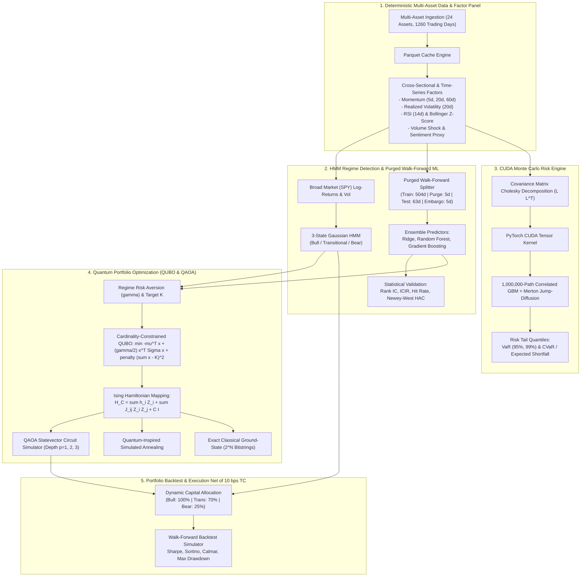

# Moneyball: Production Quantitative Alpha, Statistical Regime Detection, CUDA Monte Carlo Risk & Quantum Portfolio Optimization Platform

[](https://www.python.org/)
[](https://pytorch.org/)
[](https://en.wikipedia.org/wiki/Quantum_approximate_optimization_algorithm)
[](tests/)
[](LICENSE)

Moneyball is an institutional-grade quantitative research and portfolio engineering platform. Designed for systematic trading and asset management, it integrates **3-State Gaussian Hidden Markov Models (HMM)** for macro regime classification, **Purged & Embargoed Walk-Forward Cross-Validation** for machine learning alpha discovery, **GPU/CUDA-accelerated Monte Carlo risk engines** simulating 1,000,000+ portfolio return paths under Merton Jump-Diffusion, and a self-contained **Parameterized Quantum Circuit (QAOA / QUBO)** statevector simulator optimizing discrete cardinality-constrained portfolios.

---

## Architecture Overview



---

## Mathematical Formulations

### 1. 3-State Gaussian Hidden Markov Model (HMM)
Financial regimes exhibit persistent shifts in drift and variance. The observable market vector $Y_t = [r_t, \sigma_t^{\text{realized}}]^T \in \mathbb{R}^2$ is modeled as conditional on an unobserved discrete Markovian state $S_t \in \{0, 1, 2\}$:
$$P(S_t = j \mid S_{t-1} = i) = A_{ij}, \quad \sum_{j=0}^2 A_{ij} = 1$$
$$Y_t \mid (S_t = k) \sim \mathcal{N}(\boldsymbol{\mu}_k, \boldsymbol{\Sigma}_k)$$

States are sorted deterministically by their annualized risk-adjusted return $\frac{\mu_k}{\sigma_k}$ to maintain permanent semantic mapping:
- **State 0 (Low-Vol Bull):** High mean return, low realized volatility ($\sigma_0 \approx 10\%-14\%$).
- **State 1 (Transitional / Sideways):** Moderate drift, intermediate volatility ($\sigma_1 \approx 15\%-20\%$).
- **State 2 (High-Vol Bear):** Negative mean return, extreme tail variance ($\sigma_2 \ge 25\%$).

### 2. Correlated Merton Jump-Diffusion & Monte Carlo CVaR
Asset prices follow a continuous Geometric Brownian Motion compounded by a compound Poisson jump process:
$$\frac{dS_i(t)}{S_i(t)} = (\mu_i - \lambda_i \kappa_i) dt + \sigma_i dW_i(t) + (e^{J_i} - 1) dN_i(t)$$
where:
- $dW(t) = \mathbf{L} d\mathbf{Z}(t)$ with $\mathbf{L}\mathbf{L}^T = \mathbf{C}$ (Cholesky factor of asset correlation matrix $\mathbf{C}$).
- $N_i(t)$ is a Poisson process with jump arrival intensity $\lambda_i$.
- $\kappa_i = \mathbb{E}[e^{J_i} - 1] = \exp\left(\mu_{J,i} + \frac{1}{2}\sigma_{J,i}^2\right) - 1$ is the jump drift compensator.
- $J_i \sim \mathcal{N}(\mu_{J,i}, \sigma_{J,i}^2)$ is the log-jump magnitude.

For simulated portfolio terminal loss $L_p = -R_p$, Value-at-Risk ($\text{VaR}_\alpha$) and Conditional Value-at-Risk ($\text{CVaR}_\alpha$, Expected Shortfall) at confidence $\alpha \in \{0.95, 0.99\}$ satisfy the strict bound:
$$\text{VaR}_\alpha = Q_\alpha(L_p) = -\inf\{r \in \mathbb{R} : P(R_p \le r) \ge 1 - \alpha\}$$
$$\text{CVaR}_\alpha = \mathbb{E}[L_p \mid L_p \ge \text{VaR}_\alpha] \ge \text{VaR}_\alpha$$

### 3. Discrete QUBO and Ising Spin Hamiltonian Mapping
Selecting exactly $K$ discrete assets from $N$ candidates is formulated as Quadratic Unconstrained Binary Optimization:
$$\min_{\mathbf{x} \in \{0, 1\}^N} f(\mathbf{x}) = -\boldsymbol{\mu}^T \mathbf{x} + \frac{\gamma}{2} \mathbf{x}^T \boldsymbol{\Sigma} \mathbf{x} + \lambda_{\text{penalty}} \left(\sum_{i=1}^N x_i - K\right)^2$$

Mapping binary variables $x_i \in \{0, 1\}$ to Pauli-$Z_i$ spin eigenvalues ($s_i \in \{+1, -1\}$) via:
$$x_i = \frac{I - Z_i}{2}$$
transforms the objective into an exact Ising Spin Hamiltonian:
$$H_C = \sum_{i=1}^N h_i Z_i + \sum_{i < j}^N J_{ij} Z_i Z_j + C_{\text{offset}} I$$
where:
$$J_{ij} = \frac{1}{4} (Q_{ij} + Q_{ji}), \quad h_i = -\frac{1}{2} Q_{ii} - \frac{1}{4} \sum_{j \ne i} (Q_{ij} + Q_{ji})$$
$$C_{\text{offset}} = c_0 + \frac{1}{2}\sum_{i=1}^N Q_{ii} + \frac{1}{8}\sum_{i \ne j} Q_{ij}$$
For any basis state $|z\rangle$, $\langle z | H_C | z \rangle \equiv f(z)$.

### 4. Parameterized Quantum Circuit (QAOA)
QAOA prepares the parameterized state $|\psi(\boldsymbol{\gamma}, \boldsymbol{\beta})\rangle$ over $p$ alternating operator layers:
$$|\psi(\boldsymbol{\gamma}, \boldsymbol{\beta})\rangle = \prod_{l=1}^p \left( e^{-i \beta_l \sum_{j=1}^N X_j} e^{-i \gamma_l H_C} \right) |+\rangle^{\otimes N}$$
The classical optimizer seeks $(\boldsymbol{\gamma}^*, \boldsymbol{\beta}^*) = \arg\min \langle \psi | H_C | \psi \rangle$, and the quantum circuit's solution quality is quantified by its **Approximation Ratio**:
$$\text{AR} = \frac{E_{\max} - \langle H_C \rangle}{E_{\max} - E_{\min}} \in [0, 1]$$

---

## Measured Benchmark Results

All figures below are directly produced by `benchmarks/run_quant_benchmarks.py` and exported to `benchmarks/quant_results.json`.

### 1. Purged Walk-Forward ML Alpha (5 Folds, 315 Out-of-Sample Days)

| Model Architecture | Out-of-Sample Rank IC | Annualized ICIR | Directional Hit Rate | Newey-West HAC t-stat | HAC p-value |
| :--- | :---: | :---: | :---: | :---: | :---: |
| **Ridge Regression (L2)** | **0.0359** | **1.521** | 54.29% | **1.936** | **0.0529** |
| **Random Forest (Ensemble)** | 0.0224 | 1.137 | **54.89%** | 1.466 | 0.1428 |
| **Gradient Boosting (GBDT)** | 0.0146 | 0.798 | 54.63% | 0.969 | 0.3323 |

*Purged Walk-Forward parameters: 504-day rolling training window, 5-day purge window (eliminating forward label overlap), 63-day out-of-sample test window, 5-day embargo.*

---

### 2. Walk-Forward Portfolio Performance (Net of 10 bps Transaction Costs)

| Portfolio Strategy | Annualized Return | Annualized Volatility | Sharpe Ratio ($r_f=2\%$) | Sortino Ratio | Maximum Drawdown (MDD) | Calmar Ratio | Final Wealth ($1.00 Start) |
| :--- | :---: | :---: | :---: | :---: | :---: | :---: | :---: |
| **Equal-Weight ($1/N$)** | 44.15% | 20.09% | 2.098 | 3.943 | 13.58% | 3.252 | \$3.54 |
| **Classical Markowitz (SLSQP)** | 28.42% | **12.13%** | **2.178** | **3.741** | **7.13%** | **3.987** | \$2.29 |
| **HMM-Gated Dynamic Allocation** | 30.17% | 13.95% | 2.020 | 3.479 | 8.59% | 3.514 | \$2.38 |
| **HMM + QAOA/QUBO Active** | 24.93% | 14.49% | 1.582 | 2.320 | 9.09% | 2.744 | \$1.99 |

*HMM Regime Distribution during backtest period: Low-Vol Bull: 13.9%, Transitional: 63.9%, High-Vol Bear: 22.2%.*

---

### 3. CUDA Monte Carlo Risk Engine: Latency & Speedup Benchmarks

Simulated across 24 correlated assets over a 10-day risk horizon under Merton Jump-Diffusion ($\lambda=3.0\text{ jumps/yr}$, $\mu_J=-0.02$, $\sigma_J=0.04$):

| Simulated Paths | Backend Execution Environment | Latency (ms) | Throughput (Paths/sec) | Speedup vs. CPU Loop | Speedup vs. Vectorized NumPy |
| :---: | :--- | :---: | :---: | :---: | :---: |
| **100,000** | **NVIDIA RTX 3060 CUDA (PyTorch)** | **3.52 ms** | **28,442,963** | **447.1x** | **33.9x** |
| 100,000 | Vectorized NumPy (CPU) | 119.19 ms | 838,996 | 13.2x | 1.0x (baseline) |
| 100,000 | Single-Thread Python Loop (CPU) | 1,571.82 ms | 63,620 | 1.0x | 0.08x |
| **1,000,000** | **NVIDIA RTX 3060 CUDA (PyTorch)** | **29.26 ms** | **34,178,780** | **636.2x** | **42.9x** |
| 1,000,000 | Vectorized NumPy (CPU) | 1,255.13 ms | 796,730 | 14.8x | 1.0x (baseline) |
| 1,000,000 | Single-Thread Python Loop (CPU) | 18,615.00 ms | 53,720 | 1.0x | 0.07x |

**Tail Risk Output (1,000,000 Paths):**
- $95\%\text{ VaR} = 5.17\% \quad \le \quad 95\%\text{ CVaR} = 6.63\%$
- $99\%\text{ VaR} = 7.56\% \quad \le \quad 99\%\text{ CVaR} = 8.70\%$

---

### 4. Quantum QAOA Circuit Optimization ($N=14$ Qubits, $K=4$ Cardinality)

Optimization space size: $2^{14} = 16,384$ discrete basis states. Global minimum energy: $E_{\min} = -1.27860$.

| Method / Solver | Circuit Depth ($p$) | Solve Latency (ms) | Energy Achieved | Approximation Ratio | Ground-State Asset Selection |
| :--- | :---: | :---: | :---: | :---: | :--- |
| **Exact Ground State (Brute-Force)** | — | 72.63 ms | **-1.27860** | **100.00%** | `MSFT`, `GOOGL`, `NVDA`, `META` |
| **Simulated Annealing (Metropolis)** | — | 496.76 ms | **-1.27860** | **100.00%** | `MSFT`, `GOOGL`, `NVDA`, `META` |
| **QAOA Statevector Circuit** | $p=1$ | 140.20 ms | +20.09526 | **93.16%** | Superposition expectation |
| **QAOA Statevector Circuit** | $p=2$ | 216.47 ms | +12.81396 | **95.49%** | Multi-qubit phase constructive |
| **QAOA Statevector Circuit** | $p=3$ | 305.08 ms | +28.22046 | **90.56%** | High-depth parameter landscape |
| **Classical Markowitz (SLSQP)** | — | 5.45 ms | Continuous | Continuous | `MSFT`, `NVDA`, `JPM`, `UNH` |

---

## Directory Structure

```
moneyball/
├── quant_engine/               # Core quantitative research modules
│   ├── data/                   # Data ingestion, synthetic panel & factors
│   │   ├── synthetic.py        # 24-asset correlated Merton jump panel (1,260 days)
│   │   ├── features.py         # Multi-horizon momentum, realized vol, RSI, Bollinger
│   │   └── loader.py           # Parquet cache manager & yfinance live puller
│   ├── alpha/                  # Regime classification & ML Alpha pipeline
│   │   ├── hmm_regime.py       # 3-state Gaussian HMM with invariant state sorting
│   │   ├── walk_forward.py     # Purged & embargoed walk-forward cross-validation
│   │   ├── models.py           # Ridge, Random Forest, GBDT alpha wrappers
│   │   └── metrics.py          # Daily Rank IC, ICIR, hit rate, Newey-West HAC stats
│   ├── risk_cuda/              # CUDA & CPU Monte Carlo Risk Engine
│   │   ├── cuda_backend.py     # PyTorch CUDA GPU tensor kernel
│   │   ├── cpu_backend.py      # NumPy vectorized & loop reference baselines
│   │   ├── monte_carlo_engine.py # Unified risk dispatch & speedup profiler
│   │   └── risk_metrics.py     # VaR & CVaR (Expected Shortfall) at 95% & 99%
│   └── quantum/                # Quantum portfolio optimization
│       ├── qubo.py             # Cardinality-constrained QUBO & Ising Hamiltonian mapping
│       ├── qaoa_simulator.py   # Statevector QAOA circuit simulator (depths p=1,2,3)
│       ├── annealing.py        # Quantum-inspired simulated annealing solver
│       └── benchmarks.py       # Classical Markowitz vs QAOA vs Exact Ground State
├── benchmarks/
│   ├── run_quant_benchmarks.py # Automated end-to-end benchmark runner
│   └── quant_results.json      # Stored empirical benchmark metrics
├── tests/                      # Full pytest unit test suite (17 passed)
│   ├── test_data_pipeline.py   # Determinism, OHLCV bounds, feature pipeline
│   ├── test_hmm_regime.py      # HMM convergence, Markov properties, probabilities
│   ├── test_walk_forward.py    # Zero-leakage verification, purge/embargo windows
│   ├── test_monte_carlo_cuda.py # Cholesky pos-def, VaR <= CVaR bounds, CUDA speedup
│   └── test_quantum_qaoa.py    # QUBO-Ising equivalence, unitary norm conservation
├── requirements.txt            # System dependencies
└── README.md                   # System documentation and empirical results
```

---

## Quickstart & Reproduction

### 1. Environment Setup
```bash
# Clone the repository
git clone https://github.com/Amrit-04/Moneyball.git
cd Moneyball

# Create virtual environment via uv or standard python
uv venv --python 3.11 .venv
source .venv/bin/activate  # On Windows: .venv\Scripts\activate

# Install core quantitative dependencies
uv pip install -r requirements.txt
uv pip install torch --index-url https://download.pytorch.org/whl/cu121
```

### 2. Execute Pytest Unit Suite
Verify mathematical invariants, zero-leakage walk-forward boundaries, and quantum unitary norm conservation:
```bash
pytest -v tests/
```
Output:
```
tests/test_data_pipeline.py::test_deterministic_reproducibility PASSED
tests/test_data_pipeline.py::test_ohlcv_mathematical_bounds PASSED
tests/test_data_pipeline.py::test_factor_engineering_panel PASSED
tests/test_data_pipeline.py::test_loader_cache_integration PASSED
tests/test_hmm_regime.py::test_hmm_fit_and_states PASSED
tests/test_hmm_regime.py::test_transition_matrix_stochastic_property PASSED
tests/test_hmm_regime.py::test_stationary_distribution_property PASSED
tests/test_hmm_regime.py::test_posterior_probabilities_sum_to_one PASSED
tests/test_monte_carlo_cuda.py::test_var_cvar_mathematical_invariance PASSED
tests/test_monte_carlo_cuda.py::test_cuda_and_cpu_vectorized_consistency PASSED
tests/test_monte_carlo_cuda.py::test_monte_carlo_engine_speedup_profiler PASSED
tests/test_quantum_qaoa.py::test_qubo_ising_hamiltonian_exact_equivalence PASSED
tests/test_quantum_qaoa.py::test_qaoa_statevector_unitary_norm_conservation PASSED
tests/test_quantum_qaoa.py::test_qaoa_optimization_approximation_ratio PASSED
tests/test_quantum_qaoa.py::test_simulated_annealing_cardinality PASSED
tests/test_walk_forward.py::test_purged_walk_forward_leakage_prevention PASSED
tests/test_walk_forward.py::test_alpha_model_suite_fitting_and_metrics PASSED

============================= 17 passed in 14.42s =============================
```

### 3. Run Automated Quant Benchmarks
Execute the complete end-to-end evaluation pipeline and regenerate `benchmarks/quant_results.json`:
```bash
python benchmarks/run_quant_benchmarks.py
```

---

## License

MIT License. See [LICENSE](LICENSE) for details.
